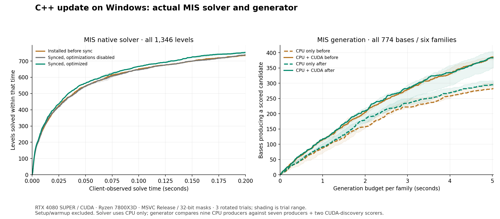

# C++ upstream refresh on Windows — 2026-11-12

Synced the actual PuzzleScript-labs checkout from `3367a2d41964ff90c5ab9a5e8eae2132e5f225f2`
to **`fa4c6583931feb1fd5821c726a887e956ffeb2ef`** (`origin/master`, 49 commits).
The performance implementation is `a564e3a415a07196a70e9f331cbc5ccbbde41035`.
All local concordance/desktop work was backed up before the fast-forward and
restored. The safety stash is retained as
`89c2590a90f872e6183fa7e1246b0ff4edf4d133`; original files and the binary patch
are in `out/upstream-performance-r1/before-source` and `local.patch`.

**Result: a useful, modest CPU improvement.** Matched solve latency is about
9% lower; on-time solver coverage rises from 734 to 752. CPU-only generation
coverage rises from 282 to 295. The combined generator establishes no new gain.
The optimized native distribution has been rebuilt, packaged and installed in
the normal MIS95 app; Automatic and its fallbacks remain the default.

## Controlled builds

All use MSVC 19.44, Release `/O2`, 32-bit masks, no LTO and no `march-native`.
Hardware: RTX 4080 SUPER / CUDA / driver 617.42, Ryzen 7800X3D, Windows.

| Version | Native helper SHA256 | Meaning |
|---|---|---|
| Before | `9a1f1d941e8898d754d624da34d22e20a6486225b54c4676fcb5321d6c6dbdc9` | Previously installed build and pre-sync JS engine |
| Synced control | `c979df97ad640ead022f72678de10a7336d2d75ccc9f38e48c4c4bee18cba378` | Synced source; `PS_PATTERN_MATCH_KERNEL=original`, `PS_INTERPRETER_TUNING=OFF` |
| Synced optimized | `09283cc5b4e05ea22b0534d31ff2e9859564f04451158af6a482537369ea62f0` | Same synced source; `anchor-cache`, tuning `ON` |

Control versus optimized isolates those runtime controls; before versus
optimized includes the broader parser/runtime sync. The control retains the
synced compiler and data structures, so it is not an exact checkout of the
pre-optimization revision. GPU binary and compiler authority are unchanged:
CUDA SHA256 `23b1fccf1fc79f7721450e86f73f2348554833c25e505d1a3676c34ccfd5ee1d`,
vanilla `5a94bde1a5127a3a45306ea28598eba2874d446d`.

The root TypeScript reference advanced to `7417d78a75b5a07402071e21e0c171a76ef8871d`.
The GPU compiler now has its own immutable `desktop/mis/backend/authority/`
snapshot. Packaging checks/stages that snapshot instead of silently substituting
the refreshed TypeScript authority. GPU discoveries still undergo CPU
assessment/original-source checking before publication.

## Full MIS native solver comparison

All **1,346 canonical levels / 184 games**, 200 ms per admitted level, eight
native workers per game, three rotated trials. This uses the actual desktop MIS
native C API/portfolio, not the separate legacy Auto controller or a 12-second
global suite budget. Client-observed latency includes queueing, packing, IPC,
native search and the original-game check. Setup/warmup are excluded from each
level's clock and retained separately. Only validated wins inside 200 ms count.

| Version | On-time solves by trial | Median |
|---|---:|---:|
| Before | 733 / 734 / 740 | **734** |
| Synced control | 742 / 739 / 733 | **739** |
| Synced optimized | 752 / 759 / 751 | **752** |

The optimized build gains **18 solves / 2.45%** over the installed version and
13 / 1.76% over the synced control. Every optimized trial exceeds every trial
of both controls.

On 2,196 matched winning base/trial observations, geometric client-latency
speedup is **1.099x** over before (about **9% less time**). Versus control, it is
1.104x across 2,207 observations.

A stricter cohort requires the same winning path and expanded count in all
three trials of both versions. On 719 such levels, median summed native request
time falls from **24.228 to 21.848 seconds** (9.82% less). Against the synced
control, 725 matching levels fall from **25.174 to 22.616 seconds** (10.16% less).
These are overlapping worker wall intervals including IPC, not process CPU
time or proof of identical internal search events. For levels with at least
100 expansions, the corresponding reductions are 8.47% and 8.55%.

Three pre-existing failed outcomes remain in every build/trial:
`dropswap.txt` levels 3 and 5, and `kishoutenketsu.txt` level 8. The native MIS
search claims a win that both its ordinary original-game checker and JS reject.
They are never counted or published as wins. All **27** failed observations are
explicit in `solver/summary.json`; that summary records `complete:true` and
`passed:false`, rather than pretending the corpus is entirely passing. The
first fail-fast run is preserved under `solver-failed-r1`.

## Full generation comparison

All **774 frozen simulation bases / six families**, five seconds per family,
three rotated trials, same authored transforms and MIS difficulty metric.
CPU-only has nine producers. Combined uses seven producers, two scorers, 512
private GPU contexts and 128 active queries. No other builds or workload tests
ran concurrently with these timings. Generation includes seed assessment,
transforms, search/refinement, validation, transport and shortlist admission.

| Version | CPU-only coverage | Median | CPU+GPU coverage | Median |
|---|---:|---:|---:|---:|
| Before | 281 / 282 / 301 | **282** | 377 / 386 / 386 | **386** |
| Synced control | 274 / 293 / 298 | **293** | 362 / 397 / 386 | **386** |
| Synced optimized | 291 / 295 / 308 | **295** | 383 / 350 / 404 | **383** |

CPU-only median coverage increases **4.61%** over before. On 840 matched
base/trial pairs with output in both arms, best difficulty rises **2.77%** and
mean shortlist difficulty 0.70%; 24 pairs have only old output, 54 only new.

Combined median coverage is essentially flat/slightly lower (**-0.78%**).
On 1,072 matched pairs, best difficulty changes **+0.39%**, shortlist **+0.78%**;
77 pairs have only old output, 65 only new. This does **not** establish a
combined-generation speedup. Versus the synced control, combined matched best
difficulty is 1.023x, with overlapping coverage ranges.

The updated combined backend still exceeds the updated nine-producer CPU
control: median **383 versus 295**, with **1.125x** matched best difficulty on
778 common pairs (116 CPU-only output pairs, 359 combined-only). This is a
comparison within this cohort, not a replacement for earlier acceptance data.

### Timing noise / focused diagnostic

The new combined Cucumber Surprise trial 1 produces only 57 covered bases;
setup takes 3.113 seconds versus roughly 0.48–0.51 normally, and recorded GPU
compute falls to 2.124 seconds versus about 3.3–3.4. The preceding native run
also has an unusually long drain. These rows remain in the primary results.

A separate repeat of that entire family/three hybrid arms gives before
110/44/58, control 113/98/54, optimized 117/75/46. Slowdowns therefore occur in
all builds, and that diagnostic is not used to replace primary rows. Subsequent
system inspection finds ProcGen FM and the Windows compositor each consuming
roughly one CPU core. GPU is idle afterward (3%, 210 MHz). Those other sessions
were not stopped. This is evidence of shared-machine contention, not a proof
of the cause of each earlier row. Treat the generator result as noisy desktop
measurements, not a clean-room benchmark or a statistical confidence interval.



## Correctness / merge regression

- **731/731** native simulation cases pass on the rebuilt interpreter.
- **44 native/WASM comparisons per build** pass for optimized and control.
- Required MIS/file checks pass after the final integration correction.
- The final JS suite passes **1,110 main cases** (731 simulations, 379 compiler
  cases) and all six auxiliary scripts.
- Independent JS checking validates **45,628** primary generator winning claims,
  **6,902** diagnostic generator claims and **6,712** solver claims: **59,242**
  accepted claims total. All 25,543 deferred GPU paths across both generator
  cohorts also replay successfully. Counts include repeated claims; each
  verifier separately reports its distinct-path count.
- A focused regression replays the three real rejected native paths on all
  builds: **nine checks** confirm both native and JS rejection. This preserves
  the finding and the publication guard; it does not fix the underlying search
  discrepancy.

The first forward-port of the old parity fix disabled cached-AGAIN selection
entirely for solver calls. That exposed an integration bug: cached turns swapped
the `level` object and invalidated the JS solver's incremental-hash bookkeeping,
causing its random-game regression to exhaust. Unmodified upstream passed that
specific regression. The final fix retains stable solver-owned level objects
while sharing ordinary AGAIN decisions and initial win checks. Both the random
replay and fast/player RNG/history regressions now pass, with a new stable-level
identity assertion. The earlier failed run is preserved. Timed native binaries
are unchanged by this final JS compatibility correction; timed engine snapshots
remain intact for provenance.

## Desktop delivery and reproduction

Normal `make desktop` succeeds with the updated native distribution/source
manifest and fresh WASM. Real packaged native solving, CUDA generation, Stop,
CUDA-disabled native mode and missing-native WASM fallback pass. The original
packaged save/reopen/minimized-generation/single-window acceptance passes in an
owned relocated snapshot. The installed app passes Automatic → JavaScript →
native switching. Tests use isolated profiles; everyday recovery data is intact.

Installed: `C:\Users\Anwender\AppData\Local\Programs\GUI95\MIS95\mis95.exe`.
The component's default helper advances to `gpu/mis/build-r6`; old binaries and
sealed evidence remain intact. No commit/push was made.

Private evidence is under `gpu/mis/out/upstream-performance-r1`, including source
snapshots, native/GPU binaries, matrices, raw outcomes, replay checks and figures.
The following commands run from the separate `puzzlescript-labs` GPU workspace.
Use fresh output directories and the frozen matrix to repeat:

```powershell
node gpu/mis/generation-bench.cjs matrix=gpu/mis/out/upstream-performance-r1/generation-matrix.json modes=native-before,hybrid-before,native-control,hybrid-control,native-after,hybrid-after ms=5000 trials=3 out=gpu/mis/out/refresh-generation-repeat
node gpu/mis/generation-verify.cjs gpu/mis/out/refresh-generation-repeat
node gpu/mis/refresh/solver-bench.cjs study=gpu/mis/out/upstream-performance-r1 ms=200 trials=3 out=gpu/mis/out/refresh-solver-repeat
node gpu/mis/refresh/solver-verify.cjs gpu/mis/out/refresh-solver-repeat
```

For further performance claims, use an idle machine or record competing-process
load throughout the run. No test applications or helpers remain running.
