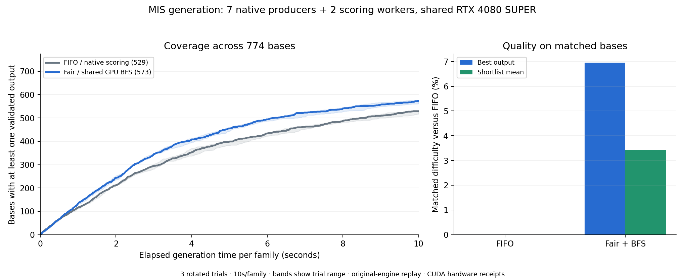

# GPU-assisted MIS scoring: Windows evaluation

The quiet-machine 10-second confirmation improves median 774-base coverage from **529 to 573 (+8.3%)**, matched best difficulty by **7.0%**, and shortlist mean by **3.4%**. Every GPU-assisted trial covers more bases than every FIFO trial. The selected one-parent configuration is now the normal Windows desktop default, with the independently verified RNG repair in native/WASM. See [promotion validation](2026-11-13-desktop-scoring-default.md).

## Configuration and authority

RTX 4080 SUPER, 80 SM, 16GiB VRAM; CUDA hardware execution; driver 617.42; Ryzen 7800X3D (16 logical CPUs), 64GiB system RAM; MSVC 19.44, installed CUDA 13.3 toolchain. GPU compiler authority is vanilla 5a94bde1a5127a3a45306ea28598eba2874d446d, manifest 77c7c0f4495e784a371658f88593cf22ea7833af4e5893ec326d135590024e98. Native is fa4c6583931feb1fd5821c726a887e956ffeb2ef plus recorded local semantics/RNG repairs, with 32-bit masks, anchor-cache and interpreter tuning. Exact source/binary hashes accompany every cohort and delivery.json. No software adapter or CPU interpreter counts as GPU validation.

## Cohorts

Every arm retains CUDA discovery and seven producers/two scorers. FIFO/native is the existing combined CPU/GPU pipeline with native scoring.

All 774 bases: 129 per authored family, six families, three rotated trials. Each family has its own budget. Setup/warmup are excluded from generation time and reported separately. Corrected admission reuses bounded discovery evidence and balances uncovered bases with aging improvements. GPU scoring retains primary/greedy/A* results while releasing CPU workers for other candidates.

| Cohort | Per-family budget | FIFO/native trials | Fair/native trials | Fair/GPU trials |
|---|---:|---|---|---|
| three-arm-r1 | 5s | 370 / 385 / 391 | 407 / 420 / 420 | 410 / 415 / 417 |
| three-arm-r2 | 5s | 383 / 388 / 399 | 458 / 467 / 457 | 453 / 458 / 457 |
| three-arm-r3 | 5s | 382 / 399 / 393 | 455 / 466 / 465 | 458 / 466 / 463 |
| confirmation-r1 | 10s | 532 / 517 / 529 | — | 561 / 573 / 576 |

Confirmation compares FIFO/native with the selected one-parent GPU arm. The earlier first admission policy gained coverage while reducing matched quality; it was revised rather than promoted. Corrected 5-second results show 458 versus 388 median coverage; the corresponding GPU arm has 457 with higher matched best/shortlist quality. Wider ordered commits make the BFS lane faster but did not establish additional generator coverage or quality, so confirmation uses the simpler one-parent kernel.

On 1,536 matched confirmation base/trial pairs, equal-length top-k quality is **7.34% higher**, and mean shortlist fill ratio is **1.19x**. Matching is performed per base and trial; unmatched outputs are counted in coverage only. Both best and shortlist quality improve in every confirmation trial.

## Costs

Native and GPU intervals sum three trials/six families. Native wall intervals overlap CPU processes; GPU event intervals overlap streams and include warmup. These sums are not exclusive CPU time or GPU utilization. Single-pool microbench separates warm lane costs without concurrent discovery.

| Arm | Median setup | Warmup | Generation | Total six-family elapsed | CPU BFS calls omitted | Native BFS fallbacks |
|---|---:|---:|---:|---:|---:|---:|
| hybrid-fifo | 4.02s | 0.51s | 60.07s | 64.59s | 0 | 0 |
| hybrid-gpu-score | 4.90s | 0.42s | 60.10s | 65.42s | 10555 | 136 |

GPU compute/upload/readback intervals and queued cancellations are separately recorded in delivery.json. Costs include capacity fallback and cancellation; larger GPUs are not assumed to be faster. In a warm, single-pool BFS-only workload capped at 256 expansions:

| Batch | Backend | Independent boards across six families/three repeats | Summed wall | Compute event intervals | Upload host | Readback device | Readback host |
|---|---|---:|---:|---:|---:|---:|---:|
| 1 | native-2-workers | 18 | 48.03ms | 0.00ms | 0.00ms | 0.00ms | 0.00ms |
| 1 | gpu-ordered-1 | 18 | 609.90ms | 554.18ms | 1.24ms | 3.69ms | 1.02ms |
| 1 | gpu-ordered-8 | 18 | 199.03ms | 180.11ms | 1.16ms | 1.06ms | 0.78ms |
| 8 | native-2-workers | 144 | 355.67ms | 0.00ms | 0.00ms | 0.00ms | 0.00ms |
| 8 | gpu-ordered-1 | 144 | 3244.64ms | 3055.24ms | 6.10ms | 13.21ms | 5.93ms |
| 8 | gpu-ordered-8 | 144 | 805.40ms | 744.63ms | 5.70ms | 4.12ms | 4.70ms |
| 32 | native-2-workers | 576 | 1680.49ms | 0.00ms | 0.00ms | 0.00ms | 0.00ms |
| 32 | gpu-ordered-1 | 576 | 7212.42ms | 6843.93ms | 23.06ms | 25.80ms | 22.03ms |
| 32 | gpu-ordered-8 | 576 | 2011.49ms | 1866.53ms | 19.60ms | 10.35ms | 16.61ms |

Within each batch size the CPU/GPU boards and limits are equivalent; board distributions differ between batch sizes. Eight parents reduce batch 32 GPU wall time 3.6x, but two C++ workers remain about 20% faster. Most GPU time is execution, not transfer. This microbench does not model overlapping discovery or claim a full-generator speedup.

## Correctness and coverage

Four cohorts pass independent original-JS replay and post-run native BFS count/path audits: **23470 scoring cases after per-cohort deduplication**. Confirmation alone checks **9341 distinct cases**, **54331 winning claims** and **16624 distinct paths**. GPU receipts, hardware/backend, zero CPU interpreter invocations and zero ordinary-successor readback are checked. Memory/deadline/unsupported outcomes remain unknown and use native fallback; their stopped GPU work is not misrepresented as a completed BFS proof.

The three historical rejected paths all used the native default seed solver:puzzlescriptmis:generated, while MIS validation used mis. Both native and WASM now use mis for every MIS search/assessment lane; generic solver defaults remain unchanged. All three fresh solutions and complete four-lane assessments replay correctly. The44 standard native/WASM cases, native seed-forwarding contract, admission/cache/bound regressions, ordinary/startup/AGAIN wins, cap/no-op/duplicate/overflow/cancellation checks, fresh native build, MIS core/file checks, normal desktop build and isolated original packaged smoke pass.

Fixtures are now owned under fixtures/; generation inputs retain their original manifest and byte hashes. No old sealed refresh results were modified. Superseded failures were instrumentation or fixture-expectation mistakes: debug-config compiler probing, incomplete result-provenance paths, comparing an unknown capacity outcome to completed native work, assuming startup always permits immediate win, and mutable before/after profiler snapshots. Corrected runs are explicitly recorded; no semantic golden was weakened. A live integration check also caught the experimental session selecting an ordinary helper that ignored deferred BFS; the default now selects the correct helper, ordinary helpers retain their already-complete native result, and multi-owner revision/cancellation lifecycle checks pass.

## Limits and next architecture

GPU scoring accepts deterministic canonical games with properties, ellipses, rigid rules, loops, AGAIN and startup rules, within 512 cells/four object words/16 wins. Random behavior and cancel/restart/checkpoint/message/audio commands use native scoring. Source parsing remains CPU-side. These are tested boundaries, not full semantic coverage. Storage is checked and dispatches have bounded fuel/continuations; capacity failure is never exhaustion or a score. Discovery/scoring share one 6GiB arena,2GiB key budget,eight pools and128 admitted queries.

Whole-assessment pruning remains disabled. Its tested evidence contract accounts for native gate/cap, effort normalization, shortlist equality, private elite capacity and adaptive quality reward. The live one/two-base observations found **zero full auxiliary private elites**, despite globally full shortlists. There is no safe private-parent cutoff to exploit in those runs. Only 1/2 of 7 protected producer workers were active; two scoring workers were busy. Raw profiles and independently replayed candidates are in out/live-profile-r2. These short observations are diagnostics, not a broad interactive-quality claim.

The plan establishes a useful bulk-generation candidate with higher coverage and matched difficulty. Keep the experiment isolated from installed defaults while addressing interactive startup/resource scheduling and fragmented parent feedback. Reuse idle CPU capacity and evaluate shared elite feedback as separate future algorithm changes; neither contribution is hidden in this benchmark. The normal source package contains the RNG correctness fix and retains its previous algorithm selection. See README.md for runnable Windows commands.

## Declared capacities

| Resource | Limit / handling |
|---|---|
| GPU board / object words / win conditions |512 cells /4 words /16 wins; unsupported shapes use native scoring |
| Per-query resident nodes |4096; logical state and hash capacity failures are explicit unknowns |
| Logical expansion cap |1,000,000; a larger supplemental cap uses a native assessment |
| Kernel fuel / hash probes / graph waves |2048 /256 /4 per unit, with explicit continuation |
| Turn continuation / AGAIN / path |100,000 rounds /10,000 ticks /65,536 path entries; failure stays unknown |
| Combined GPU owner |6GiB arena /2GiB keys /8 pools /128 admitted queries |
| Host scoring admission |512 requests /64MiB retained board budget; backpressure |
| Assessment and discovery caches |8192 entries /64MiB each, with eviction |
| Service framing |1MiB request /16MiB response; checked before parsing/export |

Host budgets describe their owned buffers/entries, not a total-process RSS limit. Native fallback is counted separately and cannot satisfy GPU validation.

Experiment workspace: C:/Users/Anwender/Documents/puzzlescript-labs/gpu/mis/scoring. Its README contains runnable commands; the normal source package retains its previous algorithm and includes the RNG repair.
